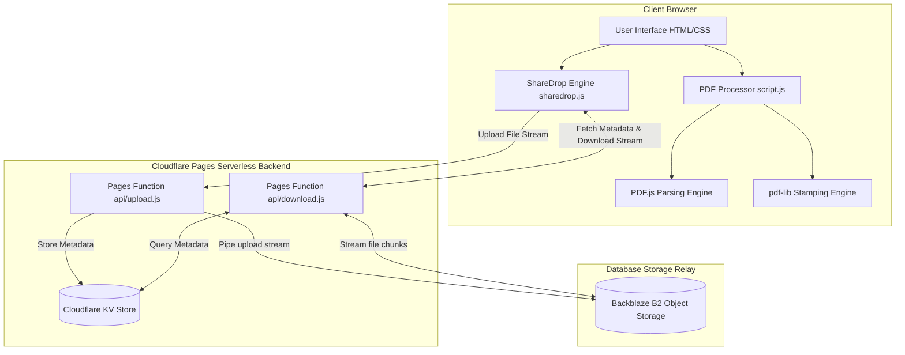

# ⚡ LABLAZY - Client-Side PDF Editor

[](https://pages.cloudflare.com/)
[](https://mozilla.github.io/pdf.js/)
[](LICENSE)

**LABLAZY** is a client-side PDF document editor and metadata stamper. PDF processing stays in the browser; authentication and the panic control channel are handled by Cloudflare Pages.

---

## 🌟 Key Features

### 📄 1. Automated PDF Editor & Metadata Stamper
* **Batch Processing:** Process multiple PDF files simultaneously right in your browser with zero server uploads.
* **Smart Text Detection (PDF.js):** Scans multi-page PDFs to detect baseline coordinates of student headers (Name, Moodle ID, Roll No, Class/Div/Branch, Subject, Instructor, Dates, Experiment Numbers).
* **Precise Canvas Whiteout & Re-Stamping (`pdf-lib`):** Erases old text fields with exact bounding-box whiteouts and redraws cleanly formatted Times New Roman Bold text across every page.
* **Direct Transfer to ShareDrop:** Transferred PDFs are cached in browser memory and imported instantly into the PDF Editor with a single click.
* **ZIP Archive Generation:** Compress all stamped PDFs into a single `.zip` file using JSZip for batch submission.

### ⚡ 2. ShareDrop (P2P File Transfer & Direct Share)
* **Zero-Server Storage:** Files stream directly from sender to receiver. Files are not stored on third-party servers permanently (10-minute temporary B2 proxy buffer).
* **Manual PIN Sharing**: Senders share a temporary 4-digit key with receivers; no persistent connection is required.
* **Storage Status Notice Board**: Shows when the REST storage backend is unavailable; manual PIN transfers remain independent of live presence.
* **Fault-Tolerant Retries**:
  * **Upload Autoretry**: Retries uploads up to 2 times automatically if a network dropout or timeout occurs.
  * **Database Sync Retry**: Polls the server database for up to 5 seconds if a receiver inputs a code before KV database replication finishes.
  * **Low-Memory Protection**: Detects mobile and low-RAM devices, recommending single-file transfers if zipping files >35MB to prevent browser crashes.

---

## 🏗️ Architecture & Tech Stack



| Component | Technology Used | Description |
| :--- | :--- | :--- |
| **Frontend UI** | HTML5, Vanilla CSS3 (Space Grotesk & Inter) | Neo-Brutalist responsive layout with custom theme toggle and 3D tilt cards. |
| **PDF Parser** | `PDF.js` (Mozilla) | Client-side text layer baseline coordinate & bounds detection. |
| **PDF Modifier** | `pdf-lib` | Standard font embedding, rectangle wiping, and coordinate text stamping. |
| **Relay Database** | Backblaze B2 | Serverless high-speed temporary storage buffer (10 min TTL). |
| **Storage & Zip** | Cloudflare KV, IndexedDB & `JSZip` | Client-side and server-side temporary file lookup, caches, and uncompressed STORE zipping. |

---

## 📁 Repository Structure

```
d:/PDF/website/
├── index.html              # Main application shell (PDF Editor + ShareDrop tabs)
├── sharedrop.html          # Redirect entrypoint for ShareDrop direct URLs
├── script.js               # Client-side PDF processing, regex detection, and IndexedDB handler
├── sharedrop.js            # ShareDrop matchmaking logic, upload/download retries, notice toggles
├── styles.css              # Main design system tokens and PDF editor styling
├── sharedrop.css           # ShareDrop brutalist card grid and modal styles
├── libs/                   # Local minified JS libraries (PDF.js, pdf-lib, JSZip)
├── functions/              # Cloudflare Pages Functions backend folder
│   └── api/
│       ├── upload.js       # Handles streaming uploads to B2 and PIN generation in KV
│       └── download.js     # Handles PIN verification and streaming downloads from B2
└── favicon/                # Web app icons and manifest
```

### Panic SSE and Durable Object broadcaster

The panic channel now uses one Durable Object named `PanicBroadcaster`.
Browsers keep one SSE connection open to it, and the Durable Object broadcasts
`PANIC_TOGGLE` directly to every connected browser. It sends a keep-alive
comment every 15 seconds and does **not** poll KV.

Normal panic operation therefore uses **zero continuous KV reads**. The
Durable Object stores the current panic state and session epoch in its own
durable storage. Middleware checks that state through the Durable Object when
handling a request, and sessions use signed cookies instead of KV session
records.

Examples:

1. **1,000 users with panic off:** 1,000 SSE connections, zero continuous KV
   reads, and keep-alive comments on the existing connections.
2. **Panic ON:** the protected `POST /panic-toggle` updates the Durable Object,
   which immediately broadcasts one event to all connected browsers.
3. **Panic OFF:** the same endpoint updates the state to inactive; new requests
   are allowed and the login wall can reload.

Configure the `PANIC_BROADCASTER` Durable Object binding, `TOTP_SECRET`,
`PANIC_ADMIN_TOKEN`, and `SESSION_SECRET`. KV remains available for unrelated
application APIs, but it is no longer used for panic polling or sessions.

### Phone control

Open `/safety-switch.html` on your phone. The page has buttons for turning
protection ON and OFF. Enter `PANIC_ADMIN_TOKEN` only when pressing a button;
the page sends it in an HTTPS `Authorization` header and clears the input after
the request. The page is intentionally reachable while protection is ON so it
can be used to unlock the site.

Anyone who discovers the page URL can view the page, but cannot change the
panic state without the token. The URL itself is not a security credential, so
keep the token private and do not save it in the page or browser storage.

---

## ⚙️ Cloudflare Pages & Database Deployment Guide

Follow these step-by-step instructions to host the repository on **Cloudflare Pages** and configure the **Backblaze B2** database storage:

### Step 1: Create a Backblaze B2 Account & Bucket
1. Go to [Backblaze](https://www.backblaze.com/) and create a free account.
2. Go to the **B2 Cloud Storage** page and click **Create a Bucket**.
3. Set your bucket name (e.g., `lablazy-transfers`) and make it **Private**. Click **Create Bucket**.
4. Take note of the **Bucket ID** and **Bucket Name** listed on the dashboard.
5. In the left navigation, click **App Keys**.
6. Scroll down and click **Add a New Application Key**. Name it `lablazy-key` and leave the settings as default.
7. Click **Create Key** and copy the **keyID** and **applicationKey** immediately (the applicationKey secret is only shown once).

### Step 2: Set up a Github Repository
1. Initialize git in the repository directory (make sure the project root containing the `website/` directory is tracked).
2. Create a new repository on GitHub.
3. Push your files to GitHub:
   ```bash
   git init
   git add .
   git commit -m "Deploying Lablazy Web App"
   git remote add origin YOUR_GITHUB_REPOSITORY_URL
   git branch -M main
   git push -u origin main
   ```

### Step 3: Deploy to Cloudflare Pages
1. Log in to the [Cloudflare Dashboard](https://dash.cloudflare.com/).
2. In the sidebar, select **Workers & Pages**, and click **Create** -> **Pages** tab -> **Connect to Git**.
3. Select your GitHub repository and click **Begin setup**.
4. Configure Build settings:
   * **Project Name**: `lablazy`
   * **Framework Preset**: `None`
   * **Build command**: Leave blank (no build command needed).
   * **Root directory**: `/website` (This ensures only the frontend website and the `functions` folder are built).
5. Click **Save and Deploy**.

### Step 4: Configure Cloudflare KV Database
1. Go back to your Cloudflare Dashboard -> **Workers & Pages** -> **KV**.
2. Click **Create Namespace**. Name it `PANIC_STATE` and click **Add**.
3. Go back to **Workers & Pages** -> **Pages** -> Click your **lablazy** project.
4. Select the **Settings** tab at the top -> **Functions** -> Scroll down to **KV Namespace Bindings**.
5. Click **Add binding**:
   * **Variable Name**: `PANIC_STATE`
   * **KV Namespace**: Select your `PANIC_STATE` namespace from the dropdown.
6. Click **Save**.

The KV namespace is used by the existing storage APIs. Panic broadcasting and
panic sessions use the `PANIC_BROADCASTER` Durable Object instead.

### Step 5: Configure the Panic Durable Object
1. Deploy `panic-broadcaster-worker/` as a separate Worker with its included
   `wrangler.toml`; this creates the `PanicBroadcaster` Durable Object.
2. Deploy the Pages project using `website/wrangler.toml`, which binds
   `PANIC_BROADCASTER` to the external `lablazy-panic-broadcaster` Worker.
3. Keep the Durable Object binding available to Pages Functions in both
   Production and Preview environments.

### Step 6: Configure Environment Secrets
1. In your project settings, click **Settings** tab -> **Environment Variables**.
2. Click **Add variables** under **Production** (and optionally Preview) and add these secrets:
   * `B2_KEY_ID` = *Your Backblaze App Key ID*
   * `B2_APPLICATION_KEY` = *Your Backblaze Application Key Secret*
   * `B2_BUCKET_ID` = *Your Backblaze Bucket ID*
   * `B2_BUCKET_NAME` = *Your Backblaze Bucket Name*
   * `TOTP_SECRET` = *Base32 secret from your Google Authenticator setup*
   * `PANIC_ADMIN_TOKEN` = *Long random token used in the panic admin Authorization header*
   * `SESSION_SECRET` = *Long random secret used to sign authentication cookies*
3. `TOTP_SECRET` is the secret seed, not the six-digit code. Enter the current six-digit Google Authenticator code in the login screen.
4. Click **Save**.
5. Go to the **Deployments** tab at the top, click the three dots next to your latest deployment, and click **Retry deployment** to apply the new environment variables and bindings.

---

## 🚀 Local Development Setup

To run and test the website locally with its serverless functions:

1. Install Node.js on your computer.
2. Install Cloudflare Wrangler globally:
   ```bash
   npm install -g wrangler
   ```
3. In one terminal, run the panic broadcaster Worker:
   ```bash
   cd panic-broadcaster-worker
   wrangler dev
   ```
4. In another terminal, run the Pages local dev server:
   ```bash
   wrangler pages dev website --kv=PANIC_STATE
   ```
5. Open the displayed local server URL (e.g. `http://localhost:8788`) in your browser.

---

## 📜 License

Distributed under the MIT License. See `LICENSE` for details.
